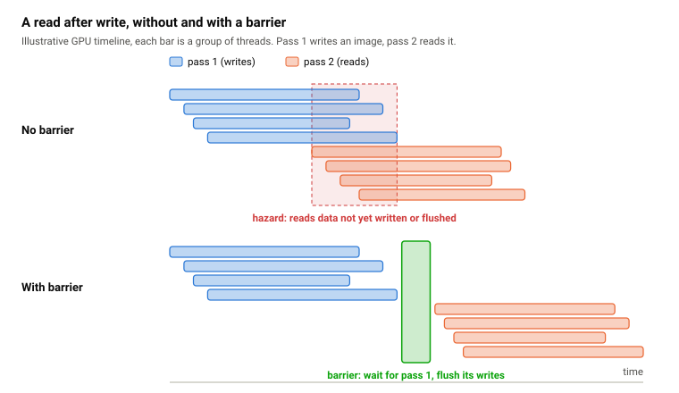
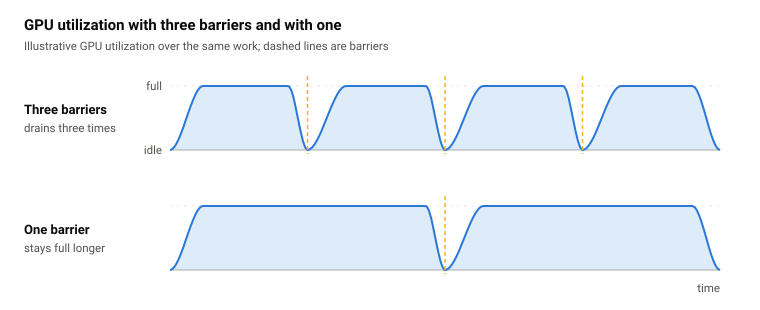
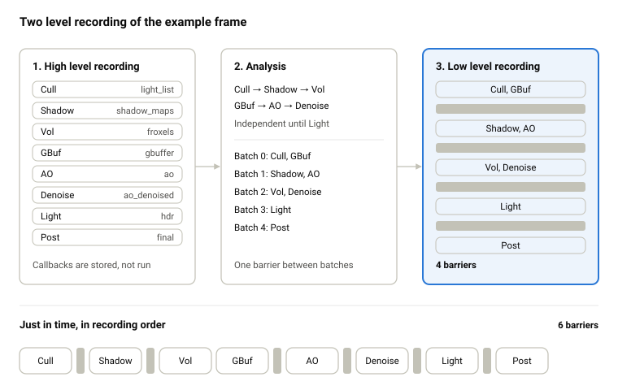

Render graphs automatically optimize the whole frame. They can generate synchronization, find a better pass order and alias transient memory, better than you would by hand.

This post builds a render graph from the bottom up. It starts with the actual problems, synchronization with barriers and memory use, and then improves the render graph step by step. The design is the one I use in [Timberdoodle](https://github.com/Sunset-Flock/Timberdoodle), my research renderer. It works on resource access timelines forming a render graph.

Render graphs give real savings in production. In my research renderer, they save around 350 MB, 20% of total VRAM or 50% of transient render memory, and around 0.2 to 0.4 ms of GPU time per frame. Other engines report similar results³ ⁶ ⁷.

Most material on render graphs either makes them more complicated than they need to be, or stops at the general idea. Here, the focus is on how the design works and what each step of the render graph improves, one optimization at a time, from the simplest and most bang for buck to the more complex ones.

What is covered:

- **Background.** How GPUs run work, why barriers exist, and why driver guessing and manual barriers don't scale. Skip it if you know barriers.
- **Core.** Two level command recording, resource timelines and barrier generation.
- **Optimizations.** From access groups, batching, reordering and memory aliasing up to the advanced ones, split barriers and async compute.
- **Conclusion and notes.** Numbers from Timberdoodle, API design, what to track, subresources, image layouts and automatic bindings.

The most important parts are the core and the optimizations up to and including memory aliasing. The rest is also very useful, but not needed for a good render graph.

## The problem: GPU execution and barriers

### GPU execution

GPUs work in passes. Each pass is a set of parallel work, like a draw, a render pass or a compute dispatch, that is processed by many threads at the same time.

The GPU may also run the threads of different passes at the same time, and once started, not necessarily in order. This is good, because overlapping passes fill more of the GPU's hardware and threads. Generally we want as much work as possible queued up on the GPU, so it never drains or runs only partially filled.


### Barriers

There is one issue with this: passes often depend on each other, and then the overlap causes hazards. The simplest one is read after write. Pass 1 writes an image, pass 2 reads it. Pass 2 must not start before pass 1 is finished, and even then pass 1's writes can still sit in caches. If pass 2 reads before they are flushed to a globally visible cache level or VRAM, it reads old data.

A barrier solves both issues of this read after write example. Pass 2 waits until pass 1 is finished, and pass 1's writes are flushed and made visible before pass 2 reads them. For other hazards like write after read, or depending on the kind of access, the memory operation a barrier does is different. For this post that doesn't matter, it's just important to know that barriers do both: they wait, and they take care of memory.



But barriers have a cost. At every barrier the GPU drains, and utilization, how many threads are actually running, drops. Afterwards it has to fill up again. More barriers means more draining:



### The issues with guessing

D3D11 places barriers for you. The driver infers how each pass accesses resources from its shader bindings and render pass attachments, and puts a barrier wherever it sees a possible dependency. A render pass drawing into an image and a compute pass reading it get a barrier in between, without you ever recording one:


Inferring only works by being pessimistic: whenever a pass might touch something an earlier pass wrote, the driver puts a barrier. Take two passes that write the same buffer. We know this is safe, because they write different sections, or because they append with atomics, like a global debug buffer that any shader writes to. The driver only sees two writes to the same resource and serializes them with a barrier in between. D3D11 does this for all writes to UAVs, which is why vendors even ship extensions to turn it off.¹ ²


With bindless resource access, inferring is impossible. A shader can access any resource at any time, and there are no bindings to look at.

The real problem is that old APIs have no way to declare how a pass accesses a resource. Vulkan and D3D12 fix this with manual sync, and that is what makes render graphs possible.

In this post I use the Vulkan terms. A barrier names pipeline stages, access flags and, for images, an image layout. D3D12 with enhanced barriers has the same three as sync, access and barrier layout. With legacy barriers, D3D12 only has resource states, which cover all three at once.

### Placing barriers by hand

Placing all barriers by hand is great for performance and control. What it lacks is flexibility.

The optimal order of passes, and where the barriers go, depends on which passes actually run. Change the rendering settings and the optimal order can change completely.

Every feature that can be turned on or off, every quality setting and every platform difference changes which passes run, and with that the optimal order and barrier placement. The combinations multiply quickly. Building and maintaining the optimal order by hand for all of them becomes complicated and hard to manage.

Big studios ran into exactly this in production. At Activision, hand placed barriers broke so often that someone spent a whole day every week fixing them, and moving to a render graph replaced about 6000 lines of glue code with about 1500⁶. Frostbite built their FrameGraph because their renderer had grown too large to manage resources and synchronization by hand³.

## Render graphs: two level command recording

So we have two extremes. D3D11 guesses and is pessimistic, Vulkan and D3D12 make you do everything by hand, which doesn't scale with code size. Render graphs are one of the mid level abstractions that came out of this. They build on the observation that low level commands can't be recorded optimally just in time: a barrier placed just in time only knows what came before, never what comes next.

The alternative is two level recording. First record into a virtual command list, then analyze it with full knowledge of all commands and resource use: place barriers better, reorder passes to need fewer of them, and alias memory. After analysis and optimization, real commands are recorded.

A render graph API makes these two levels explicit. The **high level** is the graph: passes, resources, and how each pass accesses them. The actual GPU commands inside a pass don't matter here. The **low level** is everything else: the commands of each pass, barriers, memory allocation and resource creation. The graph generates and optimizes it, and records per pass commands from a callback.

An example:

```cpp
// high level
GraphBufferId light_list = graph.add_buffer({ .size = light_list_size });
graph.add_pass(Pass::Compute("Cull")
    .write(light_list)
    .executes(cull_lights));

GraphImageId shadow_maps = graph.add_image({ .format = Format::D32_SFLOAT, .size = shadow_size, .layers = 4 });
graph.add_pass(Pass::Raster("Shadow")
    .vertex_shader_read(light_list)
    .depth_attachment_write(shadow_maps)
    .executes(draw_shadows));

GraphImageId froxels = graph.add_image({ .format = Format::R16G16B16A16_SFLOAT, .size = froxel_size });
graph.add_pass(Pass::Compute("Vol")
    .read(light_list)
    .read(shadow_maps)
    .write(froxels)
    .executes(integrate_volumetrics));

GraphImageId gbuffer = graph.add_image({ .format = Format::R32G32B32A32_UINT, .size = size });
graph.add_pass(Pass::Raster("GBuf")
    .color_attachment_write(gbuffer)
    .executes(draw_gbuffer));

GraphImageId ao = graph.add_image({ .format = Format::R8_UNORM, .size = size });
graph.add_pass(Pass::Compute("AO")
    .read(gbuffer)
    .write(ao)
    .executes(trace_ao));

GraphImageId ao_denoised = graph.add_image({ .format = Format::R8_UNORM, .size = size });
graph.add_pass(Pass::Compute("Denoise")
    .read(ao)
    .read(gbuffer)
    .write(ao_denoised)
    .executes(denoise_ao));

GraphImageId hdr = graph.add_image({ .format = Format::R16G16B16A16_SFLOAT, .size = size });
graph.add_pass(Pass::Compute("Light")
    .read(gbuffer)
    .read(ao_denoised)
    .read(light_list)
    .read(shadow_maps)
    .write(hdr)
    .executes(shade));

GraphImageId final_color = graph.add_image({ .format = Format::R8G8B8A8_UNORM, .size = size });
graph.add_pass(Pass::Compute("Post")
    .read(hdr)
    .read(froxels)
    .write(final_color)
    .executes(post_process));

// low level
void cull_lights(PassInterface pi)           { /* bind, dispatch */ }
void draw_shadows(PassInterface pi)          { /* bind, draw per light */ }
void integrate_volumetrics(PassInterface pi) { /* bind, dispatch */ }
void draw_gbuffer(PassInterface pi)          { /* bind, draw */ }
void trace_ao(PassInterface pi)              { /* bind, dispatch */ }
void denoise_ao(PassInterface pi)            { /* bind, dispatch */ }
void shade(PassInterface pi)                 { /* bind, dispatch */ }
void post_process(PassInterface pi)          { /* bind, dispatch */ }
```

This is a small deferred frame, with each resource added right before the pass that writes it.

On the high level, each pass declares the resources it uses and how, like `color_attachment_write` or `vertex_shader_read`. In compute passes, a plain `read` or `write` is enough, as the stage comes from the pass type. These are called **attachments**, a term borrowed from the color and depth attachments of render passes, extended to every resource a pass uses. The low level is the callback each pass hands over with `executes`, like `draw_gbuffer` or `denoise_ao`. Implicitly, the attachments describe a graph between the passes.

With this, the graph sees the whole frame before any real command is recorded:



### Resource timelines form the graph

After recording the graph, we have the list of passes, the resources, and how each pass uses its resources.

Passes are recorded in a linear order, and dependencies form from that order. Take the gbuffer: GBuf writes it, then AO, Denoise and Light read it. Each read depends on the write before it, which forms the dependencies GBuf → AO, GBuf → Denoise and GBuf → Light, only from the order of the passes and how they access the gbuffer.

From this we build a **resource timeline** for every resource: the list of passes that access it, in recording order, and how each one accesses it. To build it, we traverse all recorded passes, and for every attachment we add an entry to that resource's timeline.

Resource timelines are the core of this render graph design. Everything that follows, barriers, batching, reordering and aliasing, is built on them.


The recording order is the logical order of the frame, and it never changes. But the graph may reorder passes whose resource accesses don't conflict, like the two chains GBuf → AO → Denoise and Cull → Shadow → Vol in the example, which work on fully disjoint resources. That's why the graph must know about every resource that affects the correctness of reads and writes.

To reorder passes, the graph needs the logical dependencies between passes, and the timelines already dedcribe them: a write depends on the access right before it, a read on the last write. Reads don't depend on each other, so a read skips the other reads in between. To find what a pass depends on, we do this on the timeline of each of its attachments. In the example, Light reads four resources:


This finds Cull, Shadow, GBuf and Denoise. Doing this for every pass gives the full pass graph, here drawn without the edges that are already implied through other passes:


This is different from most other render graphs, which build an explicit pass graph³ ⁴ ⁵. Here it is not required, because the timelines effectively already form one, and all algorithms work directly on them.

### Generating barriers from the timelines

From the timelines we have all the information we need to place correct barriers for every constraint that resource accesses form between passes.

To keep things simple, for now we execute the passes in the order they were recorded. Generating the barriers is then simple. We go over each resource timeline, and at every change of access we need a barrier, to keep the frame correct and avoid hazards, like a read after a write. We calculate which barrier that change needs, and place it as late as possible, right before the first pass of the new access.

An example with two resources. GBuf writes depth, HiZ builds a depth pyramid hiz from it, Cull reads hiz for occlusion culling, and Water draws into depth again:


This stays true later. No matter how we reorder passes, as we always keep logical order the timelines declare, the barriers can be simply generated by analyzing timelines.

To get fine grained barriers, the API and each access should provide information that is relatively detailed. The graph must know the pipeline stage of each access, either coarsely from the type of the pass, like a compute read or a graphics read, or finely from the specific access type, like an indirect command read or a vertex shader read. The access flags can also matter as much, for example a shader read compared to a generic memory read. Especially on AMD, a more specific access type can make the barrier itself execute faster.

In the API, each attachment carries this information. The comments show what each one maps to in Vulkan, without the VK\_ prefixes:

```cpp
// in a compute pass, plain reads and writes get the stage from the pass type
graph.add_pass(Pass::Compute("Cull")
    // stage DRAW_INDIRECT, access INDIRECT_COMMAND_READ
    .indirect_command_read(dispatch_args)
    // stage COMPUTE_SHADER from the pass type, access SHADER_STORAGE_WRITE
    .write(draw_commands)
    .executes(cull_meshes));

graph.add_pass(Pass::Raster("Draw")
    // stage DRAW_INDIRECT, access INDIRECT_COMMAND_READ
    .indirect_command_read(draw_commands)
    // stage COLOR_ATTACHMENT_OUTPUT, access COLOR_ATTACHMENT_WRITE,
    // layout COLOR_ATTACHMENT_OPTIMAL
    .color_attachment_write(scene_color)
    .executes(draw_scene));
```

Images also need the right layout, or resource state in D3D12, for each access. The barrier we place at a change of access also does this transition. Just read or write alone is not enough to pick the layout, so the attachment's access decribes this as well. A color attachment write maps to COLOR\_ATTACHMENT\_OPTIMAL, a compute shader read to READ\_ONLY\_OPTIMAL, a copy source to TRANSFER\_SRC\_OPTIMAL, and so on. Buffers have no layout in Vulkan, but legacy D3D12 barriers also give them a state, like INDIRECT\_ARGUMENT for an indirect command read.


This is a first, naive barrier placement in recording order, and the worst we will see in this post. The following optimizations use the rest of the information we already have.

Vulkan and D3D12 also have split barriers. They get their own section later, because everything else is simpler to explain with normal barriers first.

## Grouping accesses

The barrier placement from the last section already places just one barrier for reads in a row, as long as nothing changes between them. Two optimization opportunities present themselfes for reads:

- Read after read barriers. Reads never conflict, so two reads in a row only need a barrier when the layout or state changes between them, for example when one pass samples an image and the next copies from it as a transfer source.
- Scanning previous reads. The barrier for the next write has to cover the pipeline stages of every read since the last different access, so we have to scan back over all of them to collect their stages.

Take the image from the layout example again, with one more pass: Light writes hdr, SSR and Exposure sample it, Copy copies it for refraction, and Transparent draws into it again. The change of access rule gives three barriers, one of them only for the layout change before Copy, and the barrier before Transparent needs the stages of SSR, Exposure and Copy. With a read group, there are two barriers and no scan:


Merging consecutive read accesses fixes both. Consecutive reads of the same resource form one access on the timeline, a read group. All reads in the group use one merged layout, so there are no read after read transitions. The group also builds a merged set of pipeline stages and access flags of its reads, updated each time a pass joins, so the barrier to the next write takes them straight from the group without any scan. Reads should never depend on each other, so they should not form a dependency on the timeline just because their layouts differ. This matters most for reordering, which comes later.&#32;

Access groups are the first barrier reduction we do, and they are only possible because of two level command recording and the timeline analysis.

The merged layout is the next higher one that covers all reads of the group. In the example, the sampled reads want READ\_ONLY\_OPTIMAL and the copy wants TRANSFER\_SRC\_OPTIMAL. A copy source only allows TRANSFER\_SRC\_OPTIMAL or GENERAL, so the group gets GENERAL. D3D12 can combine read states, so there the group gets PIXEL\_SHADER\_RESOURCE | COPY\_SOURCE with legacy barriers, or the GENERIC\_READ layout with enhanced barriers. Losing the optimal layout for each single read is a small price for getting rid of a barrier.


Writes can be grouped the same way. An attachment can be marked as **write concurrent**, and consecutive write concurrent accesses then form one group like reads, while normal writes are never grouped. This is the case from the beginning of the post, where D3D11 serialized two safe writes to the same buffer, writing different sections or appending with atomics, like a global debug buffer. We know these writes are safe, the graph can't, so we mark them. On the timeline it is still one entry per group, so once read grouping exists, this is a simple addition.

## Batching passes

Before reordering passes, we should consider batching. It is a structured grouping of passes, and the rest of the graph optimizations build on it.

If you inspect the barrier example in the generating barriers section, you might have noticed that one barrier is not well placed: the one for depth between Cull and Water. Water only depends on HiZ, so its barrier could just as well move up to the barrier for hiz, before Cull. Then both are recorded in one API call, merged into one barrier, and we get rid of one drain.


To do that, we find sets of consecutive passes that are independent of each other, and move all the barriers they need in front of the whole set, as one merged barrier. In the example, that is Cull and Water, so the barriers for hiz and depth both go in front of Cull. Such a set is a **batch**. Passes in a batch can overlap on the GPU, and barriers only sit between batches.

We get these batches from a simple linear scan over the passes in recording order. A pass joins the current batch as long as it doesn't depend on any pass in it. Otherwise a new batch starts, and all barriers needed at that boundary are recorded in one API call, as one merged barrier, so fewer batches also mean fewer drains.


Like access groups, this optimization is only possible because we have two level command recording. We analyze the passes for consecutive passes that form batches first, and place better barriers later, when we actually record the commands.

## Reordering passes

Now to the meaty part. Reordering is perhaps the most bang for buck optimization that a render graph and two level command recording allow.

One of the biggest benefits a render graph can provide is reducing the total barrier count. Batching and access groups already help, but so dar we are still stuck with the recording order of passes. Since we know all passes ahead of time, we can reorder them (without breaking logical order), with the goal of as few batches, and so as few barriers, as possible, down to the critical path of the frame.

### What reordering may change

The timelines declare the logical order. Each one is a chain of accesses, and reordering must never change the order of the entries on any timeline. What it may change is the order of passes that don't share a timeline entry. Passes inside one access group are not ordered against each other, so they may swap. An example: Light writes hdr, SSR and Exposure read it, Transparent draws into it again, and Particles simulates into its own buffer:


SSR and Exposure are one read group, so swapping them keeps the hdr timeline the same. Particles shares no timeline with the others and can go anywhere. Moving Transparent before Exposure puts a write before a read of the group, and moving SSR before Light reads hdr before it is written. Both change the hdr timeline and break the frame.

The timeline should only describe the logical order of accesses. Lower level details like a layout change must not add dependencies to it, because every dependency limits reordering. Without access groups, a layout change between two reads would split them on the timeline, so a sample and a copy of the same image could never swap, even though neither depends on the other. Access groups keep these reads together, and the merged layout is decided per group, independent of the order of the passes inside it.

### Example

Take two chains of two passes. You record GBuf and AO, where AO reads the gbuffer, then Cull and Shadow, where Shadow reads the light list. GBuf and AO only touch the gbuffer, Cull and Shadow only the light list, so the two chains are logically independent. Batching in recording order doesn't help much here: AO depends on GBuf, and only Cull can join AO's batch. That gives three batches and two barriers. But since the chains are independent, they could run side by side: GBuf next to Cull, AO next to Shadow.


### Algorithm

The critical path in this example is two passes long. Getting there is a small change to how we build batches. Before, a pass could only join the current batch or start a new one. Now it may go into any batch, as long as all its dependencies are in earlier batches. This is called **scheduling as early as possible**: every pass goes into the earliest batch it is allowed to go.

We go through all passes in recording order. For each attachment, we look up the access on the resource timeline it depends on: for a read, the last write, for a write, the last access of any kind. The pass needs a barrier after that access, so it goes into a later batch. We take the maximum over all attachments, as that is the only batch that satisfies all of them. If that batch doesn't exist yet, we append it.

Let's run this on the two chains from the timelines above. We place the passes one by one in recording order, the new one is highlighted:


This algorithm gets us the desired result, two batches and one barrier instead of two. But this is a trivial example.

Here is a second example, where passes have several attachments. It is the frame from the beginning. Batched in recording order, it needs seven batches, because the shadow chain and the AO chain are recorded one after the other, and only GBuf can join Vol's batch. The rule for reordering stays the same: a pass goes into the batch right after the latest batch it depends on, or into batch 0 if it has no dependencies.


The same algorithm step by step. Each attachment gives an earliest batch, and the pass takes the maximum:


In the pass graph from earlier, the result is easy to see. The longest chain, GBuf to AO to Denoise to Light to Post, is five passes long, so five batches is the minimum. For barrier count, scheduling as early as possible is optimal, as the longest chain of dependent passes sets the minimum number of batches. On an explicit graph, the same idea is known as longest path layering, or a level wise topological sort. Muratov calls these batches dependency levels⁵.

### Scheduling access groups

The access groups from earlier need one extra step when reordering. The passes of a group are not ordered against each other, so they can land in different batches. An example:


The two reads of depth form one group, but SSR also reads hiz from HiZ, so it lands one batch later. The write of Water depends on the whole group. As described earlier, one dependency on a group is implicitly a dependency on all of its passes, here HiZ and SSR. So when scheduling Water we don't have to scan all prior reads in the timeline, as we already merge those in one access. By storing the min and max sheduled batch of the passes in the group, dependent passes (Water in this cade) only read the max and goes into the batch after it. Groups of concurrent writes work the same way.

## Aliasing memory

The next big optimization is aliasing memory. The driver can't really do this, as it doesn't reliably know when a resource is last used. The graph does, so we can exploit the effective lifetimes of resources. Many resources are **transient**: they only live for a part of the frame, start out as garbage, get written, used for a while, and are done. Modern APIs let us share the memory of such resources, while the resource objects themselves stay alive, so nothing is recreated.

This is also why the earlier example uses `add_image` and not `create_image`. Like passes, resources are only recorded. They are created and placed into aliased memory only after the graph has reordered the passes and calculated the memory layout.

A typical renderer has tons of candidates:, for ezample hierarchical Z and culling buffers early in the frame, bloom mips late in the frame. They never exist at the same time, so they can share memory:


Doing this by hand is very finicky, and every feature toggle shifts the lifetimes again. Again, the render graph does it for us. It has a full overview of the frame, the resource timelines tell it when each transient resource lives, and with this it can find all aliasing opportunities by itself.

### A simple allocation strategy

The lifetimes again come straight from the resource timelines. The first access on a resource's timeline gives the batch of its first pass, the last access the batch of its last pass. The lifetime is the range from that first to that last batch.

The strategy is to first sort the transient resources by lifetime, longest first, and then find the lowest possible address for each one. We allocate in 2D, with the memory offset on one axis and the timeline on the other. Each resource is a rectangle of its lifetime and its memory range, so checking for free space is a simple rectangle intersection test.

Intuitively, long lived resources are hard to alias with anything else. If one sits in the middle of the heap, you get a Tetris problem. Its long allocation blocks everything around it, and because allocations have to be contiguous, nothing can be split around it.

So the long lived allocations go solid at the start of the heap, and the shorter lived ones are stacked on top. As these towers of smaller allocations grow, they leave bigger and bigger gaps, and the remaining small, short lived resources fit nicely into these holes.


On a frame with many more resources, the result looks like this:


It is like filling a glass with sand. Put the big grains in first, and the small grains later fill the gaps between them. Do it the other way around, and the big grains sit on top and leave gaps the small grains can't fill anymore.

### Caveat: reordering works against aliasing

These two optimizations work against each other. Scheduling every pass as early as possible makes sections of the frame overlap that would otherwise not overlap. Resources that could share memory are now alive at the same time, and the aliasing opportunity is gone.

In practice this is usually not a big loss. Graphics frames in big games typically have a long, deep pipeline anyway, so there are still plenty of aliasing opportunities left after reordering. But it is a real effect, and keeping the recording order can often save a bit more memory through aliasing.

## Wiggling passes for aliasing

Once the passes are reordered, we can run another heuristic after it that increases the opportunities for aliasing, and importantly, does not increase the critical path. It is based on intuition, but it works well in practice.

The top is the order we have after reordering. The bottom has the same batches and loses no barrier optimality, but clouds no longer overlaps the gbuffer, so they can share memory:


Some passes are not locked in place, because they are not part of the critical path. In this example, that is Clouds and CloudUp, which render and upscale volumetric clouds for Post. They can move around, like shown above, without changing the correctness or the optimality of the barriers, so they have some room to wiggle. The heuristic tries to wiggle them into the best spots for aliasing, without sacrificing any barrier efficiency.

What matters most is the direction, and we go from back to front. Since every pass is scheduled as early as possible, all the free room to move is towards the back of the frame. If we went front to back, Clouds would be blocked by CloudUp and stay where it is, only CloudUp would move, and we would need another iteration to move Clouds too. Going back to front, CloudUp moves first and makes room, then Clouds follows, and both move in one single pass:


To decide if a move is worth it, we need a cost function, because a single move can add and remove aliasing opportunities at the same time. Moving a pass later has two effects:

- Resources it **reads** whose lifetime ends at this pass live longer, so their area grows.
- Resources it **writes** whose lifetime starts at this pass start later, so their area shrinks.

To estimate which effect is more impactful, we use the virtual surface area of each resource lifetime: its lifetime in batches multiplied by its size. A move is good if the total area of all resources goes down.

The algorithm is a single sweep. Find all passes that can still move without changing the batch structure. Then go through them from the last batch to the first. For each pass, keep moving it one batch later, as long as no dependency breaks and the total area goes down. As soon as a move would increase it, stop.

## Avoiding subchannel switches

Barriers are not the only thing that drains the GPU. On NVIDIA, switching between kinds of work, transfer, compute and graphics, causes a subchannel switch, which drains the GPU much like a barrier. So we also want as few switches between kinds of work as possible.

A simple way to get there is to mark every pass with its kind: transfer, compute or graphics. Then there are two easy optimizations.

First, sort the passes inside each batch by kind. The passes in a batch are independent of each other, so any order inside a batch is legal:


Second, we augment the wiggle step from the previous section. While it moves passes around, without hurting aliasing or the critical path, we also try to make batches homogeneous. If a compute pass can move out of a mixed batch into a batch that is pure compute so far, we move it, because this removes a subchannel switch:


## Splitting barriers

I consider this an advanced optimization. It adds a lot of complexity, and how well it works depends heavily on the hardware vendor and the driver. The theoretical benefits are great, but drivers and actual numbers often lag behind.

Vulkan and D3D12 also offer split barriers, with events in Vulkan. They let other work run between the start and the end of a barrier, and with that they can remove false dependencies. A normal barrier waits on all earlier work in the stages it names, not only on the pass that forms the dependency.

An example: P1 writes A and is short, P2 writes B and runs long, P3 reads A and writes C, P4 reads B and C. This gives three batches: P1 and P2, then P3, then P4. With a normal barrier before P3, P3 also waits for P2, even though it only needs A from P1. With a split barrier for A, the begin goes right after P1 and the end only waits for P1. P3 starts while P2 is still running, and the work finishes earlier:


With batching, the begin of a split barrier should always go directly after the pass that forms the dependency, not after the end of its batch. The ends, the actual waits, are combined with the normal barriers into as few API calls as possible.

For split barriers to work well, the batching also has to be adjusted. With one combined wait at the start of a batch, the whole batch still waits for its most recent dependency, and the split barrier gains little. So we sort the passes of each batch into two groups: **far** passes, whose dependencies are all at least two batches back, and **near** passes, which depend on something in the directly previous batch.

Each batch then gets two waits. The first wait, at the start of the batch, covers the far dependencies. Their split barriers began long ago, so this wait is usually free. The far passes run next, and while they run, the previous batch finishes and signals its split barriers. The second wait comes right before the near passes and covers the dependencies on the previous batch. In the ideal case, where every batch has some far work to run first, all barrier waits are hidden behind that work.


There is a catch. With the scheduling described so far, ignoring the aliasing wiggle, far passes never exist. Every pass is scheduled as early as possible, so it always lands in the batch right after its latest dependency, which makes every pass a near pass. The example above already assumes the step that fixes this.

Like for aliasing, we can wiggle passes that are not on the critical path further back in the frame, without lengthening the critical path. This plants far passes into batches that would otherwise only have near passes, and gives the near wait something to hide behind.

On NVIDIA, this planting also has to consider subchannel switches. A planted far pass only overlaps well if the batch has the same kind of work around it. A compute pass planted into a graphics batch causes a subchannel switch and serializes again.


A caveat: when I last tested this, the drivers on NVIDIA and AMD mostly treated a split barrier as a normal barrier at the wait point. So in practice, the theoretical benefit is sadly not reached. It can even get worse: a batch with far and near passes now issues two waits instead of one, and on such drivers each wait drains the GPU. That means more drains and lower performance than plain batching with one barrier per batch.

## Using async compute and multiple queues

Like split barriers, this is an advanced optimization, for the same reasons.

First, what multiple queues allow. Each queue is processed by its own command processor on the GPU, working through its own stream of commands. Barriers are local to their queue. So in theory, you get two streams of execution, each with its own barriers, that don't affect each other. A drain on one queue can be filled with work from the other.

This gives two benefits. ALU heavy work and bandwidth or latency heavy work can run at the same time, which reaches a better total use of the hardware. And while one queue drains on a barrier, the other queue can keep the GPU filled:


Async compute is also the one I trust automation with the least. All three designs referenced earlier support it in some form. Frostbite makes it an opt-in per pass³, Themaister uses semaphores and concurrent sharing between queues⁴, and Muratov builds an algorithm to minimize the synchronization between queues⁵. None of them show performance numbers, and I think there is a reason for that.

Async compute behaves very differently between GPUs, between vendors, and even between generations of the same vendor. What helps on one GPU can hurt on another. In practice it has to be tuned by hand. I don't see fully automatic approaches working: there are many methods that are quite optimal in theory, but they don't work out well in practice.

A manual approach also has to keep submits to an absolute minimum. Submits are expensive on both the CPU and the GPU, and every sync between queues needs one. On top of that, code running on multiple queues can be very confusing to work with.

So I chose a simple manual design that is still powerful. The user splits the render graph into sections that end in a submit, and the graph is not allowed to reorder passes across these submits. Within a section, passes can be marked to run on another queue. The analysis verifies that this is possible: it is only allowed if every resource the pass uses is only used on that exact queue within the section. Resource access is transferred between queues at the submits. In Vulkan, all resources touched by several queues use concurrent sharing mode, which avoids queue family ownership transfers.

Even then, multiple queues can make performance worse. The overlap itself can cause GPU stalls, the submit boundaries reduce what reordering can do, resources used across queues reduce aliasing opportunities, and every extra submit has its cost. It has to be built and tested by hand, case by case, on the GPUs you care about.

## Precomputing static graphs

All optimizations so far save GPU time or memory. This last one saves CPU time. Recording the graph can be a significant cost (within milliseconds), and it is not easy to parallelize. I have personally seen, in multiple projects, the recording step alone take over a millisecond of CPU time on the critical path.

The common idea is that a render graph is recorded again every frame. Every frame you record all passes, declare all resources, run all optimizations, create all descriptors, and then execute it. In most cases this is wasteful, because the structure of the frame rarely changes. It also limits how much the graph can optimize. Each optimization typically needs at least one scan over all passes, so a graph rebuilt every frame can afford fewer of them.

The alternative is a static graph. You record the passes and resources once, or only on rare occasions, like a level load, a settings change or between cutscenes. Never on the fly, because even then it can cause small stutters. This is usually enough. Changing the structure of your frame every frame is usually an anti-pattern anyway, because it becomes unpredictable and hard to debug.

Activision splits it the same way. Their full build, running the setup, building dependencies, scheduling and creating heaps and resources, happens at level load and takes 10 to over 100 ms. Per frame they only evaluate a few conditions and pick a cached permutation, which costs 0 to 1 ms⁶. Frostbite goes the other way and builds its graph from scratch every frame, assuming the setup is cheap because there are relatively few passes and resources³.

```cpp
// dynamic graph: record and execute every frame
while (running) {
    auto graph = record_graph(settings);
    graph.execute();
}

// static graph: record only when the settings change
auto graph = record_graph(settings);
while (running) {
    if (settings_changed) { graph = record_graph(settings); }
    graph.update_dynamic_resources({ .swapchain_image = acquire_swapchain_image() });
    graph.execute();
}
```

The static form lets you precompute a lot. The pass order, the memory layout and all optimizations are done once. The graph can also pre-create everything it needs for recording, like debug names, descriptor sets or tables, uniform or constant buffers, command pools (command allocators in D3D12), the resource objects for transient resources and the memory blocks they alias into. Each frame, it only executes.

Of course some things do change every frame, like the swapchain image. These are **dynamic resources**, resources that can change between graph executions or that live outside the graph. During recording, the graph notes every place where a dynamic resource is used. Before each execution, we take the latest resource, go through this list, and touch up the descriptors, the constants and the precomputed barriers. Passes that are only optionally executed work the same way.

This usually only affects a small fraction of resources, let's say under 5%. So the extra overhead is tiny, and the static precomputation still saves the other 95%.

## Conclusion

A render graph is a two level command recording model. The high level describes passes and how they access resources, the low level records the commands of each pass. Because the high level is known ahead of time, the library can do all the work we would otherwise do by hand.

All of it is built on the resource timelines. From them we get correct barriers, access groups and batches with merged barriers, the dependencies for reordering passes down to the critical path, the lifetimes for aliasing memory, and the room to wiggle passes for better aliasing and fewer subchannel switches. The graph between passes stays implicit, and most steps are just a lookup of the previous entry on a timeline.

It also pays off in practice. In my research renderer Timberdoodle, with around 80 passes, all render graph optimizations together save around 0.2 ms of a roughly 10 ms frame on an RTX 4080, and around 0.4 ms of a roughly 11 ms frame on an RX 9070 XT. Aliasing alone saves around 350 MB, half of the transient memory and roughly 20% of the total VRAM. This is in line with what others report. Activision's task graph renderer saves 100 to 500 MB depending on platform⁶, and Frostbite saves about half of its transient resource memory in Battlefield 1 through aliasing³. AMD replayed captures of about 60 games through their own render graph library and measured far fewer barrier calls and GPU frame time reductions of up to double digit percent on an RX 7900 XTX⁷.

The notes below go into API design and a few practical details that are worth knowing when building one.

## Notes

### A question of API design

Everything above comes from treating a render graph as a high level description of the frame: which passes run, which resources they use, and how. The graph itself only exists implicitly in the resource timelines.

The render graph in [Daxa](https://github.com/Ipotrick/Daxa) is the one described in this post, and the API of the examples here is also similar to Daxa's.

Many render graph APIs work differently and version resources. Each write creates a new version of the resource, and later passes have to refer to the right version, so every in-between state has to be declared and named. Frostbite's FrameGraph³, which many later render graphs build on, works like this:


Versions also imply immutable state. Every version is in principle a new resource, so either the graph makes constant copies, or it has to optimize them away implicitly, which is fragile. Besides being unintuitive, it makes graphs hard to build programmatically. Its one advantage, building the graph fully out of order, is really a downside, because code is best written top down and linear. It also pushes people towards global identifiers, like string constants or global ID definitions, which are unnecessary and inefficient. I find it much nicer to have value semantics and mutable resources.

I prefer treating graphs and passes as plain data. The backend can manipulate them freely for optimizations, and users can generate graphs in code: functions take resources and return new ones, so graphs compose through normal function calls, and loops can add passes several times, for example for mip generation.

For this, resources are just typed indices. They are values, not identifiers, so they can be passed around, returned and stored in structs like any other value. Passes don't even need an ID. An example:

```cpp
struct GBuffer {
    GraphImageId albedo;
    GraphImageId normal;
    GraphImageId depth;
};

struct Lighting {
    GraphImageId color;
};

GBuffer add_gbuffer(Graph& graph, Extent size) {
    GBuffer gb = {
        .albedo = graph.add_image({ .format = Format::R8G8B8A8_UNORM, .size = size }),
        .normal = graph.add_image({ .format = Format::R16G16_SFLOAT,   .size = size }),
        .depth  = graph.add_image({ .format = Format::D32_SFLOAT,      .size = size }),
    };
    graph.add_pass(Pass::Raster("GBuf")
        .color_attachment_write(gb.albedo)
        .color_attachment_write(gb.normal)
        .depth_attachment_write(gb.depth)
        .executes(draw_gbuffer));
    return gb;
}

Lighting add_lighting(Graph& graph, GBuffer const& gb, Extent size) {
    Lighting l = { .color = graph.add_image({ .format = Format::R16G16B16A16_SFLOAT, .size = size }) };
    graph.add_pass(Pass::Compute("Light")
        .read(gb.albedo)
        .read(gb.normal)
        .read(gb.depth)
        .write(l.color)
        .executes(shade));
    return l;
}

GraphImageId add_downsample_chain(Graph& graph, GraphImageId src, u32 count) {
    for (u32 i = 0; i < count; ++i) {
        GraphImageId dst = graph.add_image({ .format = Format::R16G16B16A16_SFLOAT, .size = half_size(graph, src) });
        graph.add_pass(Pass::Compute("Downsample")
            .read(src)
            .write(dst)
            .executes(downsample));
        src = dst;
    }
    return src;
}

// the frame is just function calls
GBuffer      gbuffer  = add_gbuffer(graph, size);
Lighting     lighting = add_lighting(graph, gbuffer, size);
GraphImageId bloom    = add_downsample_chain(graph, lighting.color, 6);
```

No string or global resource IDs, no in-between states. Each function only knows the resources it gets, and the graph figures out the rest.

You may have noticed the builder pattern for passes. I usually quite dislike builder patterns, because they hide complicated machinery for constructing objects without need. But render graphs are a special case: a pass can carry a lot of attachments with a lot of detail each. After trying different options, I came to the conclusion that a builder is one of the most convenient and syntactically concise ways to declare passes, if not the most convenient one, at least from the perspective of someone writing C++.

### Resources inside the pass

Graph resource IDs are a high level concept. They can't be used to record real commands: after `add_image`, the index doesn't point to any real image yet. So inside the pass callback, we need a way to get from the resource ID to the pass's attachment data, which then gives us the real API resource. The pass captures the IDs it needs, and the pass interface resolves everything about them: the real image or buffer, views, size, format, a bindless index, or potentially any other attachment related information.

```cpp
graph.add_pass(Pass::Compute("Light")
    .read(gbuffer.normal)
    .write(lighting.color)
    .executes([=](PassInterface pi) {
        // pi resolves the virtual resource ids from graph recording (GraphImageId)
        // to the real resources behind them
        ImageViewId normal = pi.view(gbuffer.normal);
        ImageViewId color  = pi.view(lighting.color);
        Extent      size   = pi.info(lighting.color).size;
        // bind, push constants, dispatch
    }));
```

The important step here is mapping a resource to its attachment in the current pass, which is cheap. Every resource index fits into a u16, which is enough for any graph. Each pass stores an array of u16s, one per attachment, holding the resource index of that attachment. Finding the attachment for a resource is then a search in this tiny array.

A linear scan is already cheap. With a bit of SIMD it gets even cheaper: one 256 bit compare checks 16 u16s at once. Passes rarely have more than 16 attachments, and even an extreme pass with 64 needs only four compares, followed by a bit scan to get the attachment index.

```cpp
// linear scan, already cheap
u32 find_attachment(Pass const& pass, u16 resource) {
    for (u32 i = 0; i < pass.attachment_count; ++i)
        if (pass.attachment_resources[i] == resource) return i;
    return NOT_FOUND;
}
```

### Don't track all resources

Not every resource belongs in the graph. Only resources whose access changes often during the frame, or that can be exploited for aliasing, should be tracked: render targets, intermediate images and buffers, culling data and so on.

Resources like meshes, textures for models or material data are uploaded once and then only read. Tracking them is needless bloat: they add attachments and timeline entries to many passes, but never need a barrier between passes and never alias with anything. It is much easier to handle them separately, for example with one barrier after their upload, and then access them in any pass.

### Subresource tracking

Vulkan and D3D12 let you track the state of every single subresource of an image: every plane, layer and mip can have its own layout and its own access.

In practice it is rare that a renderer ends up with a subdivided state like this. And even when it does, it is very questionable if fine grained tracking gives you any performance.

What it does give you is complexity. Subresource tracking is error prone, even when it is automated, and it can make the graph API uglier and the internals more complicated.

It can also cost CPU performance. I have seen graph recording get noticeably slower because of degenerate cases that are easy to miss, for example an image with many mips and array slices that is used in an unusual way. The tracking cases can add up and take a surprising part of the CPU budget.

There is another case against it. Where subresources are accessed very differently from each other, which is where automatic subresource tracking might actually help, it is better practice to split them into distinct resources. Separate resources can be memory aliased automatically, while one big resource can't.

While it does have merit, the benefit is usually so small compared to its complexity that I recommend just not doing it. So my first recommendation is to **track one state for the whole resource.** One last access, one last pass on the timeline, and for images one layout. Never track per subresource. It is not useful and actively harmful: uglier API, buggier code, slower code, no benefit.

### Image layout tracking

Where do image layouts, or resource states in D3D12, actually matter in practice? Mostly for graphics attachments, so color, depth and MSAA, sometimes for certain formats, and for transitions from those to read, transfer, general and present. And only really on older AMD GPUs. On RDNA 3 and newer, NVIDIA, Intel, Qualcomm and most mobile vendors they don't matter. Even on GCN the gain is small and situational, mostly very high bandwidth G-buffer passes and transparency with a lot of overdraw.

But they can hurt a lot. With Vulkan 1.0 synchronization you get many false layout transitions, for example between two reads that each want a different optimal read layout. Every render graph sees a hard dependency there, so there is a barrier and a drain in between, on every GPU, even though many of these layouts don't even exist in hardware. Synchronization 2 improved this a lot with fewer, more generic layouts.

We can go further. The only layouts that really matter are UNDEFINED, GENERAL and PRESENT\_SRC (UNDEFINED, COMMON and PRESENT with D3D12 enhanced barriers). Using only these removes even more false dependencies, gives fewer barriers overall, and makes the layout logic and the whole render graph backend much simpler.

So my second recommendation is to **just use the general layout if you can, and don't track the others.** In D3D12, the COMMON layout of enhanced barriers is the equivalent. This is one of the places where Vulkan and D3D12 focused very hard on GCN and older GPUs, and it is basically an artifact of that time that no longer matters.

### Bindings from attachments

Because the graph already knows every attachment of every pass, it can also take work off your hands. With a little more information in the attachments, the graph can generate descriptors for a pass, or automatically fill a buffer or push or root constants with the bindless indices of its resources. So you write even less code per pass.

This is also good for performance. The graph knows all of this before execution, so it can pre-allocate the memory for these buffers, or pre-create the descriptors and cache them, instead of building them again every frame.

For this the graph needs one more piece of information per attachment: where the shader expects the resource. The simplest way is to tell it the binding slots, and there is a more automatic way I like, which I mention at the end.

**Shared binding indices.** The simplest way, and a good start, is to give every attachment a binding index that C++ and the shader agree on. A small shared header holds the indices, the pass declaration passes them along with each attachment, and the shader uses the same indices to look the resources up:

```cpp
// shared between C++ and the shader
namespace LightBinding {
    static const u32 GBUFFER      = 0;
    static const u32 AO_DENOISED  = 1;
    static const u32 LIGHT_LIST   = 2;
    static const u32 SHADOW_MAPS  = 3;
    static const u32 HDR          = 4;
}

// C++: the binding index travels with the attachment
graph.add_pass(Pass::Compute("Light")
    .read(gbuffer,     LightBinding::GBUFFER)
    .read(ao_denoised, LightBinding::AO_DENOISED)
    .read(light_list,  LightBinding::LIGHT_LIST)
    .read(shadow_maps, LightBinding::SHADOW_MAPS)
    .write(hdr,        LightBinding::HDR)
    .executes(shade));
```

```hlsl
// shader: the graph filled this array, the index is the binding slot
struct LightPush { ResourceId resources[5]; };
[[vk::push_constant]] LightPush push;

// ...
Texture2D<uint4> gbuffer = get_image(push.resources[LightBinding::GBUFFER]);
RWTexture2D<float4> hdr  = get_image(push.resources[LightBinding::HDR]);
```

Before the callback of a pass runs, the graph writes the real resource id of every attachment into the slot named in its declaration, into push constants or a buffer. Pass and shader agree on the slots only through the shared header. This needs no tooling and works with any shader language. The price is that the indices are maintained by hand, and nothing checks that the shader's array and the pass's attachments really match.

**Static reflection with macros.** For bigger renderers I prefer to go one step further and declare each pass once, in a file shared by C++ and the shader, with macros that expand differently in each language. [Daxa](https://github.com/Ipotrick/Daxa) does this with its task heads. The declaration lists the attachments and how each one is accessed. In the shader it compiles to a struct of resource ids and buffer pointers, and in C++ to a struct of metadata about the pass and its attachments, which the graph uses to fill the shader struct for you. That makes the declaration the API of the pass's shader, in C++ and in the shader at once, and that is what I like about it. But the simplest way, for sure, is the shared binding indices from above.

## References

1. Intel, [UAV overlap sample](https://github.com/GameTechDev/UAVOverlapSample)
2. AMD, [AGS documentation: DX11 UAV overlap](https://gpuopen-librariesandsdks.github.io/ags/group__dx11_u_a_v_overlap.html)
3. Yuriy O'Donnell, *FrameGraph: Extensible Rendering Architecture in Frostbite*, GDC 2017. [Talk](https://www.gdcvault.com/play/1024612/FrameGraph-Extensible-Rendering-Architecture-in), [slides](https://www.slideshare.net/DICEStudio/framegraph-extensible-rendering-architecture-in-frostbite)
4. Hans-Kristian Arntzen (Themaister), [Render graphs and Vulkan — a deep dive](https://themaister.net/blog/2017/08/15/render-graphs-and-vulkan-a-deep-dive/), 2017
5. Pavlo Muratov, [Organizing GPU Work with Directed Acyclic Graphs](https://levelup.gitconnected.com/organizing-gpu-work-with-directed-acyclic-graphs-f3fd5f2c2af3)
6. Charlie Birtwistle and Francois Durand, [Task Graph Renderer at Activision](https://enginearchitecture.realtimerendering.com/downloads/reac2023_task_graph_renderer.pdf), REAC 2023
7. Zhuo Chen, [The Render Pipeline Shaders SDK](https://gpuopen.com/download/Introducing_RenderPipelineShaders_SDK.pdf), AMD, December 2022
8. Daxa, [task heads](https://docs.daxa.dev/wiki/taskgraph-bottom-up/) and the [macro definitions](https://github.com/Ipotrick/Daxa/blob/master/include/daxa/utils/task_graph.inl)
